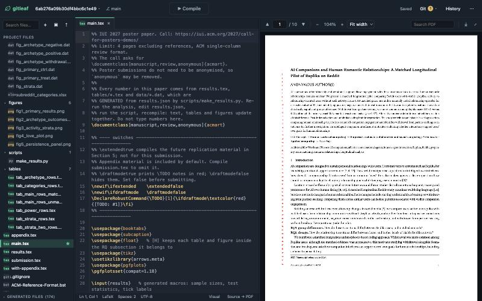

<p align="center">
  
</p>
<h1 align="center">gitleaf</h1>
<p align="center">
  A small, fast Overleaf-style LaTeX editor that runs on your own machine.<br>
  Every paper is a plain git repository, so your work lives on GitHub, Overleaf's git bridge, or any remote you like.
</p>

<p align="center">
  <a href="https://github.com/kmarkiv/gitleaf/releases/latest"></a>
  <a href="https://github.com/kmarkiv/gitleaf/actions/workflows/ci.yml"></a>
  <a href="LICENSE"></a>
</p>

<p align="center">
  
</p>

## Download

One file, no installer. Download, run, and your browser opens on the editor.

<table align="center">
  <tr>
    <td align="center" width="200">
      <a href="https://github.com/kmarkiv/gitleaf/releases/latest/download/gitleaf-macos-arm64">
        
      </a><br>
      <a href="https://github.com/kmarkiv/gitleaf/releases/latest/download/gitleaf-macos-x86_64"><sub>Intel Mac</sub></a>
    </td>
    <td align="center" width="200">
      <a href="https://github.com/kmarkiv/gitleaf/releases/latest/download/gitleaf-windows-x86_64.exe">
        
      </a>
    </td>
    <td align="center" width="200">
      <a href="https://github.com/kmarkiv/gitleaf/releases/latest/download/gitleaf-linux-x86_64">
        
      </a><br>
      <a href="https://github.com/kmarkiv/gitleaf/releases/latest/download/gitleaf-linux-arm64"><sub>ARM64</sub></a>
    </td>
  </tr>
</table>

| Platform | First run |
|----------|-----------|
| macOS | `chmod +x gitleaf-macos-arm64 && xattr -d com.apple.quarantine gitleaf-macos-arm64 && ./gitleaf-macos-arm64` <br> The `xattr` step is needed once because the binary is not notarized; or right-click the file, choose Open, and confirm. |
| Windows | Double-click `gitleaf-windows-x86_64.exe`, or run it from a terminal. SmartScreen may ask once; choose "Run anyway". |
| Linux | `chmod +x gitleaf-linux-x86_64 && ./gitleaf-linux-x86_64` |

**Requirements:** `git` (Git for Windows on Windows). A LaTeX installation is optional: when none is found, the
first Compile offers to download a checksum-verified [Tectonic](https://tectonic-typesetting.github.io/), a self-contained engine that
fetches packages on demand. The editor, PDF worker, math renderer, fonts and PDF decoder assets are bundled into the
binary. Opening and editing projects needs no browser internet access. Git remotes, template
browsing, engine downloads and uncached Tectonic packages still need a network connection. All checksums are in `SHA256SUMS.txt` on the release page.

Running it a second time opens the browser only after verifying that the running service is GitLeaf
with the same root and cache. An occupied port belonging to another service is reported as an error. Options:

```
gitleaf [--root DIR] [--cache DIR] [--port N] [--no-open]
```

| Variable / flag | Default | Meaning |
|-----------------|---------|---------|
| `GITLEAF_ROOT`, `--root` | `~/Documents/gitleaf` | Folder holding one git repository per paper; existing `~/Documents/Codex/Overleaf` is used for compatibility |
| `GITLEAF_CACHE`, `--cache` | OS cache folder | Compile outputs and the downloaded Tectonic |
| `GITLEAF_PORT`, `--port` | `8077` | Listen port, on 127.0.0.1 only |
| `GITLEAF_ENGINE` | auto | `latexmk` or `tectonic` |
| `GITLEAF_NO_OPEN`, `--no-open` | | Do not open the browser on start |
| `GITLEAF_NO_UPDATE_CHECK` | unset | Disable automatic GitHub release checks; manual checks remain available |

## What it does

- **Three panels, one button.** File explorer, LaTeX editor, PDF preview, and a prominent Compile. Dividers
  drag, double-click resets, the explorer collapses (⌘B), and Focus mode (⌘⇧F) hides everything else.
- **Projects are git repositories.** The project menu lists them, creates new ones from built-in templates
  (article, ACM sigconf, IEEE, Springer LNCS, beamer, thesis), browses the Overleaf gallery by tag, clones any git
  URL or an Overleaf project link (over Overleaf's git bridge), or unpacks a zip from a URL or disk.
- **Explorer.** Search, collapsible folders, type badges, ★ for the main file (guessed from `\documentclass`),
  new file, new folder, upload or drag-and-drop, right-click for rename, download and delete. Build outputs sit
  in a collapsed "Generated files" group.
- **Editor.** CodeMirror 6 with tabs, bracket matching, find and replace, a status bar, and a Source/Visual
  switch. Grammarly and similar extensions work on it. Edits autosave 1.5 s after you stop typing; saves are ordered, and typing during a save triggers a follow-up save. Files are replaced atomically so a failed write does not truncate the original; the toolbar
  says "Saved" or "● Unsaved", and the Git menu says what is uncommitted and unpushed, so the two are never
  confused.
- **Visual mode.** Prose, headings and lists as rich text; tables, figures, display math and the title rendered;
  captions editable; double-click any rendered block to edit its LaTeX. Untouched LaTeX round-trips byte for byte.
- **Compile.** `latexmk` when installed, else Tectonic. The status beside Compile reads "✓ Compiled successfully
  · 2.3s" or "✕ Compilation failed · 3 errors"; failures open a Problems panel (click a row to jump to the line)
  with a Logs tab. The last PDF that compiled cleanly stays on screen when a new compile fails.
- **PDF viewer.** Page navigation, zoom, fit width or page, text search, download, fullscreen; the position
  survives recompiles. SyncTeX both ways: ⌘J jumps from the cursor to the PDF, double-click in the PDF jumps to
  the source line.
- **Git.** Commit (with a review of changed files), Push, Pull, History, all through the system `git`, so the
  credentials and SSH keys git already uses keep working.

### Importing from Overleaf

Overleaf only hands out template sources to logged-in users, so the gallery tab guides you: pick a template,
press Import to open it in Overleaf, press *Open as Template* there, come back, and the new project's address
is picked up from the clipboard; press Import again and gitleaf clones it over `git.overleaf.com`. Pull and
Push then keep it in sync with Overleaf. Existing projects: paste their link into the *Git / Overleaf project*
tab. The git bridge needs your Overleaf git token once; git remembers it.

## Build from source

Requires a current stable Rust toolchain, Node.js 22.13 or newer (Node 24 is used in CI), npm and Git.
Configure your Git name and email before creating projects; GitLeaf reports a failed initial commit
instead of silently creating an incomplete project.

```bash
git clone https://github.com/kmarkiv/gitleaf.git
cd gitleaf
npm ci
npm run build
cargo build --release --locked
./target/release/gitleaf
```

On Windows, run `target\release\gitleaf.exe`. End users running a release binary do not need Node,
npm or Rust. `static/assets/` is generated and ignored by Git; regenerate it after frontend changes.
The Rust build embeds every asset, so the finished binary does not need a separate web server or
an assets folder at runtime. Third-party license notices are available at
`http://127.0.0.1:8077/assets/THIRD_PARTY_NOTICES.txt`.

`./run.sh --no-open` builds and runs on Unix. Set `GITLEAF_REBUILD_UI=1` after changing the frontend,
or run `npm run build` explicitly. The launcher forwards command-line options to the binary.

## Validation

```bash
npm ci
npm run build
npm test
cargo fmt --check
cargo clippy --locked --all-targets -- -D warnings
cargo test --locked
cargo build --release --locked
npm audit --audit-level=high
cargo install cargo-audit --locked
cargo audit
```

The Rust suite exercises path containment, protected Git metadata, archive extraction, checksum
verification, log parsing, SyncTeX, durable writes and actual HTTP routes, including request limits
and cross-origin protection. The JavaScript suite tests saves that overlap, edits made during a
save, retries after failure, and refusing to compile a continuously changing unsaved document.

For browser checks, install Chromium and run against the freshly built binary:

```bash
npx playwright install chromium
GITLEAF_BIN="$PWD/target/release/gitleaf" npm run test:browser
```

The browser suite starts an isolated server with temporary projects and a deterministic test
compiler. It verifies offline startup (all external browser requests blocked), corrupt preference
recovery, project creation, editing, save races, PDF preservation after failure, visual-mode source
preservation, Focus Mode, project switching and layouts at 900, 1366, 1440 and 1920 pixels.
It does not modify your papers or Git identity and does not substitute for testing a real TeX engine.
To exercise the installed engine, run `GITLEAF_BIN="$PWD/target/release/gitleaf" npm run test:latex`.
This uses temporary projects and a temporary Tectonic package cache; it checks real compilation,
both SyncTeX directions, structured errors and PDF preservation. Set `GITLEAF_REAL_ENGINE=latexmk`
to check a TeX Live installation instead. The first Tectonic run may download packages.
Screenshots are written to `test-artifacts/` (or `GITLEAF_SCREENSHOT_DIR`).

### Updates

GitLeaf checks its GitHub releases on startup and every six hours. Set `GITLEAF_NO_UPDATE_CHECK=1`
to disable automatic checks for offline or restricted environments. A failed check does not block
editing. View → Check for updates can still perform an explicit check.

Release binaries offer an Update button when a newer compatible release is published. The updater
saves pending edits and pauses editing, downloads only from the official repository over HTTPS,
requires the exact asset checksum from `SHA256SUMS.txt`, checks the executable's version, and then
replaces it on the executable's own filesystem. Active HTTP work drains before a direct process
restart; no shell command is constructed. Source builds show the release page and must be rebuilt
with the frontend assets. The actual binary replacement/restart needs a release smoke test on each
platform; unit tests cover version comparison, URL validation and exact checksum selection.

## Operating GitLeaf

GitLeaf is a local application for one trusted user. It binds to `127.0.0.1` and has no login or
multi-user permission model. Open it directly at the printed localhost address. Public hosting and
reverse-proxy deployments are not supported by this configuration.

- Back up the projects root, including each repository's `.git` directory. Autosave writes to disk;
  it does not create a Git commit or push to a remote. Uncommitted or never-committed deletions cannot
  be recovered from Git. Commit and push important milestones.
- Keep root and cache in separate directories; nested or identical paths are rejected at startup.
  The cache contains derived outputs and an optional downloaded engine, and can be regenerated.
- Existing cache files from v0.3.0 use the previous naming layout. Compile once after upgrading to
  generate outputs in the new per-main-file cache; projects and source files are unchanged.
- Ctrl-C and SIGTERM drain active requests before shutting down. External commands time out after
  five minutes; their output is bounded to 8 MiB per stream. Unix process groups and Windows process
  tree termination are used when a command times out or exceeds its output budget.
- JSON requests are limited to 8 MiB; binary uploads and source ZIPs to 64 MiB. ZIP extraction refuses
  symlinks and nonportable paths, allows at most 10,000 entries, and bounds each expanded file to
  64 MiB and the total to 512 MiB. Project ZIP downloads are capped at 512 MiB of source data.
- Project paths protect `.git` at every depth and through symlink aliases. Standalone repositories
  are supported; Git worktrees whose `.git` is a pointer file are not.
- Browser requests must use the app's own localhost host, port and origin. Cross-origin requests,
  DNS rebinding hosts, and embedding in other pages are rejected. Uploaded SVG content is sandboxed.
  These protections do not authenticate other programs running on the same machine.
- LaTeX is executable input. Compile trusted projects only. Tectonic uses `--untrusted`; latexmk
  disables shell escape and local initialization files (`-no-shell-escape`, `-norc`). These options
  reduce risk but are not an OS sandbox. Projects requiring shell escape or custom latexmkrc behavior
  need a separately managed trusted build workflow.
- Tectonic installation requires `curl` and `tar`, an official HTTPS release URL and a GitHub-provided
  SHA-256 digest. Releases without a digest, checksum failures and binaries that fail `--version`
  are refused. Install Tectonic manually on PATH if automatic installation is unavailable.

### Troubleshooting

| Symptom | Action |
|---|---|
| Git is missing | Install Git and ensure it is on PATH before starting GitLeaf. |
| Project creation fails at initial commit | Configure `git config --global user.name` and `git config --global user.email` in your terminal, then retry. |
| Port is occupied | Stop the other service or choose `--port 8078`. An existing GitLeaf with different root/cache also requires another port. |
| No LaTeX engine | Install TeX Live/latexmk or Tectonic; select explicitly with `GITLEAF_ENGINE=tectonic` or `latexmk`. |
| Compilation fails | Use Problems and Logs; the previous successful PDF remains available. Compile again after fixing the source. |
| Editor says Save failed | Keep the tab open. Check disk space, file permissions and the server process, then use Save again. |
| Browser requests return 403 | Use the direct `http://127.0.0.1:PORT` or `http://localhost:PORT` address, with the configured port. |
| Assets missing during Rust build | Run `npm ci` and `npm run build` first. |

## Releasing

CI runs frontend tests, Rust formatting, static checks, unit/HTTP tests and release builds on Linux,
macOS and Windows. Linux also runs browser regressions. A separate job checks RustSec advisories.
These workflows must pass on the release commit before shipping; local testing cannot validate all
three operating systems.

Keep `Cargo.toml`, `package.json` and their lockfiles on the same version. Tag a validated commit
`vX.Y.Z` and push it. `.github/workflows/release.yml` builds macOS (Apple silicon and Intel), Linux
(x86_64 and ARM64) and Windows binaries with locked dependencies. It verifies version/tag agreement,
attaches `SHA256SUMS.txt`, and creates a **draft** GitHub release for review before publication.
The download links above point to the latest published release, not untagged source changes.

Signing/notarization and Windows code signing are not configured. Review platform smoke tests,
artifact checksums and release notes before publishing a draft.

## Layout

- `src/main.rs`: configuration, router, existing-instance verification, browser launch and shutdown.
- `src/api.rs`: projects, files, compilation, SyncTeX, Git and template discovery.
- `src/update.rs`: cached release checks and verified, graceful self-updates.
- `src/security.rs`: localhost/origin checks and browser security headers.
- `src/storage.rs`: durable atomic file replacement.
- `src/assets.rs` and `build.rs`: embedded browser assets.
- `src/tests.rs`: regression tests through the actual HTTP router.
- `src/templates.rs` and `templates/`: built-in project templates.
- `static/index.html`: application markup.
- `frontend/`: editor behavior, styles and the save coordinator.
- `scripts/build-ui.mjs`: reproducible local browser bundling and license notices.
- `tests/`: JavaScript unit tests and isolated browser regressions.

## Limits

- Single trusted user; no authentication, public hosting or real-time collaboration. Collaboration
  uses Git and your existing credentials.
- The bundled editor can work offline; Tectonic still needs cached packages to compile offline.
- Visual mode is a view of the source, not a word processor. Nested environments and custom macros
  may appear as raw LaTeX blocks.
- Compiler output and large project operations are bounded. A request beyond a limit returns an
  error; long compiles may need a separate trusted terminal workflow.
- Git credentials are used from the system configuration. Interactive credential prompts are
  disabled, so establish credentials in a terminal before cloning/pushing protected repositories.
- Modern desktop browsers are required. Chromium is exercised in the automated browser suite;
  Safari and Firefox need separate release smoke tests.

## License

[MIT](LICENSE) © 2026 Vikram Cannanure
